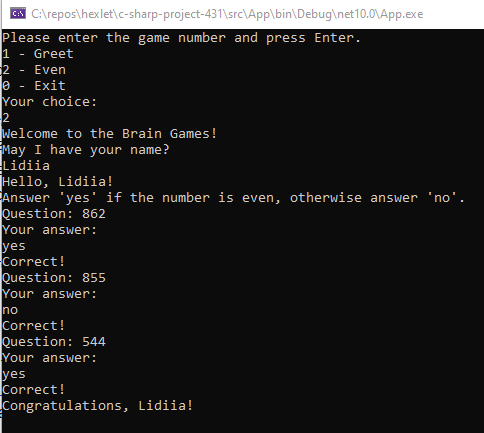
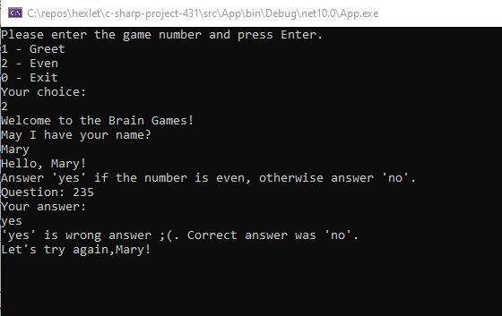
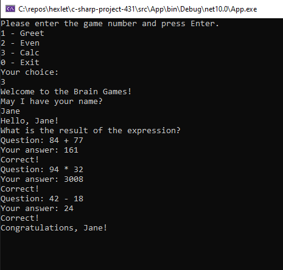
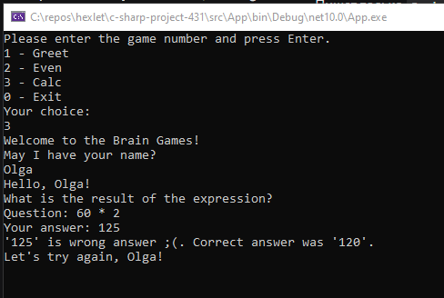
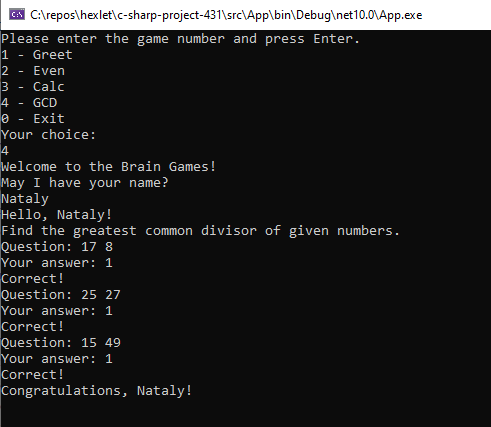
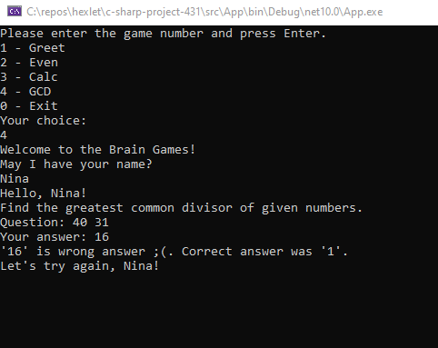
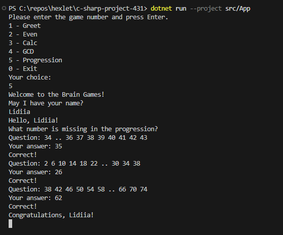
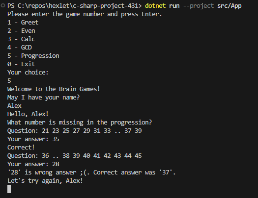
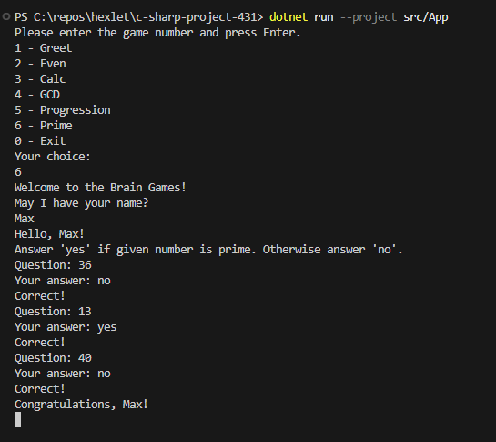
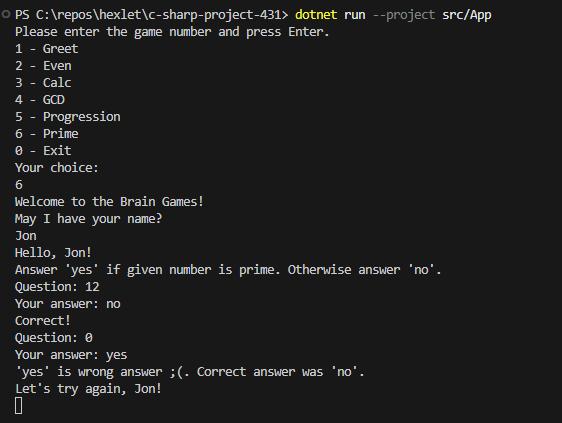

# Игры разума (C#)

[](https://github.com/apatheiagit/c-sharp-project-431/actions)

Погрузитесь в экосистему .NET, научитесь настраивать рабочее окружение. Освоите dotnet CLI — инструмент создания, сборки и запуска проектов, и CSharpier, форматтер кода. Поймёте, чем git отличается от GitHub, поработаете с внешними репозиториями. Получите опыт построения архитектуры полноценного приложения и написания чистого кода.

Учебный проект Хекслета: https://ru.hexlet.io/programs/c-sharp


## Стек

- Csharp

## Установка

<!-- Опишите установку: клонирование, зависимости, переменные окружения -->

```bash
git clone https://github.com/apatheiagit/c-sharp-project-431.git
cd c-sharp-project-431
```

## Использование

Пример запуска игры "Проверка на чётность", победы и поражения игрока:

**Правильный ответ:**



**Неправильный ответ:**



Пример запуска игры "Калькулятор", победы и поражения игрока:

**Правильный ответ:**



**Неправильный ответ:**



Пример запуска игры "Наибольший общий делитель (НОД)", победы и поражения игрока:

**Правильный ответ:**



**Неправильный ответ:**



Пример запуска игры "Арифметическая прогрессия", победы и поражения игрока:

**Правильный ответ:**



**Неправильный ответ:**



Пример запуска игры "Простое ли число?", победы и поражения игрока:

**Правильный ответ:**



**Неправильный ответ:**




---

<details>
<summary>Автоматические тесты Хекслета</summary>

Тесты запускаются на каждый коммит. За запуск отвечает файл `.github/workflows/hexlet-check.yml` — не удаляйте и не переименовывайте ни его, ни репозиторий.

</details>

## О Хекслете

[Хекслет](https://ru.hexlet.io/) — школа программирования: авторские программы обучения с практикой, поддержкой наставников и реальными проектами, которые остаются в резюме. Этот репозиторий — один из таких проектов.
